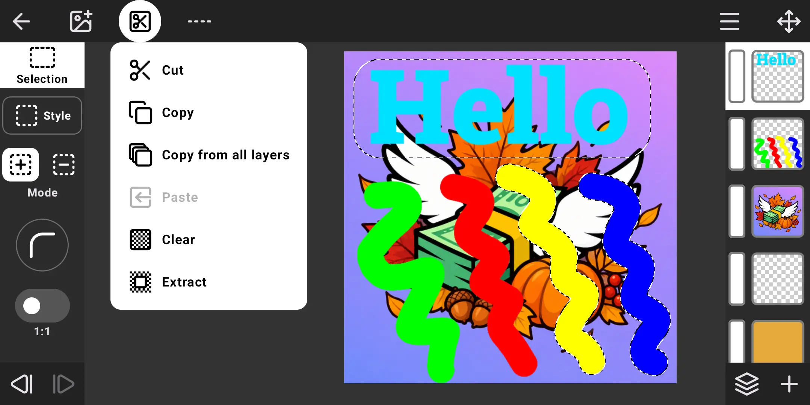
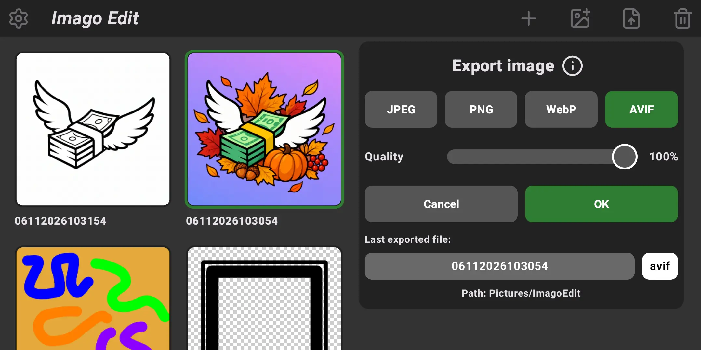
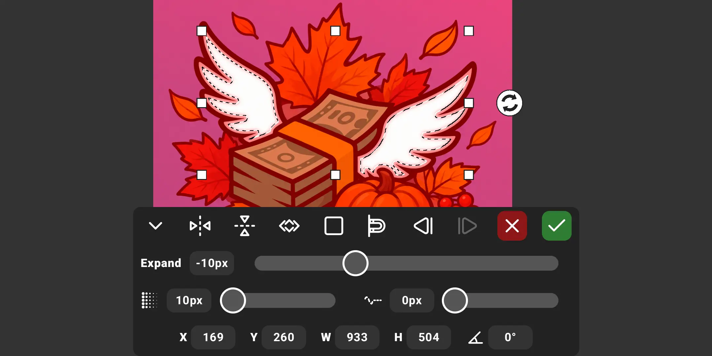
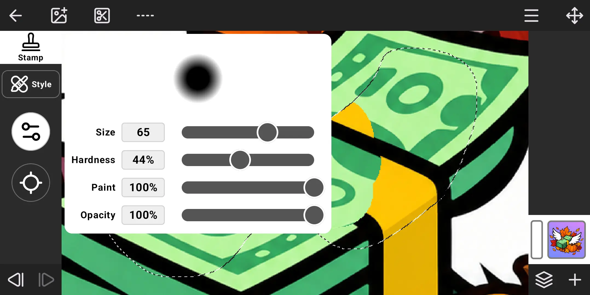
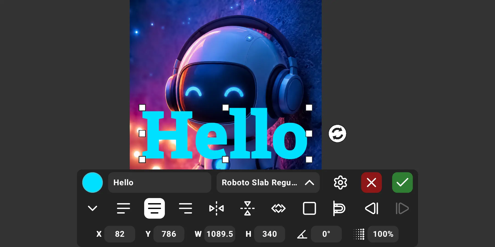

# ImagoEdit

[](https://www.gnu.org/licenses/gpl-3.0)
[](#requirements)

A layer-based raster image editor for Android.
It works fully offline: no ads, no analytics, no internet permission.

- Up to 100 MP canvases, 16 000 px per side.
- Layers with blend modes, selections, drawing, clone stamp, healing brush, eraser, blur brush, text, opacity transition.
- Image corrections and effects: brightness, contrast, sharpness, saturation, temperature, shadows/highlights, color balance, tint, replace color, Gaussian and directional blur, shadow, glow and more.
- Export to PNG, JPEG, WebP and AVIF with its own native JPEG/WebP encoders.
- Projects live in folder on the device and stay there when the app is uninstalled.
- Project autosave.



## Contents
- [Screenshots](#screenshots)
- [Features](#features)
- [Limits](#limits)
- [Requirements](#requirements)
- [Download](#download)
- [Where files are stored](#where-files-are-stored)
- [Known limitations](#known-limitations)
- [How it works](#how-it-works)
- [Building from source](#building-from-source)
- [Project structure](#project-structure)
- [Contributing](#contributing)
- [Third-party](#third-party)
- [License](#license)

## Screenshots
<p align="center">
  
  
</p>
<p align="center">
  
  
</p>

## Features

### Projects
- Project grid with thumbnails, sorted by last change.
- New project with a set canvas size (aspect-ratio lock), or a project made from an image.
- An image is imported as is or at a lower resolution chosen before import, with its aspect ratio kept.
  This works for new projects and for **Add image**.
- Opens images from other apps: **Open with** and **Share.**
- Rename (tap the name) and delete several projects at once
- On exit: **Save**, **Save a copy** or **Exit without saving.**

### Layers
- Add an empty layer, duplicate a layer or make a layer from the selection.
- Show/hide, reorder, opacity 0–100 %, delete.
- Blend modes: Normal, Darken, Multiply, Lighten, Screen, Overlay, Soft Light, Difference, Exclusion, Color.
  They work the same on the canvas, in merged layers and in exported images.
- Merge with the previous layer, merge visible layers or merge all layers.
- **Add image** puts a photo onto a new layer and opens the Move tool on it.

### Selection
- Styles: **Square** (corner radius, custom size or 1:1), **Circle** (custom size or 1:1), **Lasso**, **Polygon** (with the footsteps of history), **Magic wand** (tolerance 0–255, contiguous or every matching pixel), **Brush**.
- Modes: new, add, subtract.
- Menu: select all, deselect, select a layer's pixels, invert
- **Transform selection**: expand or shrink the edge, blur, smooth the outline, move, scale and rotate the selection itself.
- Brushes, eraser, stamp, and paint fill within a selected area, including soft edges.
- **Edit** menu: cut, copy, copy from all layers, paste (into the current or another project), clear, extract.

### Painting and retouching
- **Drawing**: size, hardness, flow, opacity.
- **Eraser**: the same settings. It writes a mask, the layer's pixels stay unchanged.
- **Stamp**: clone from a source point that keeps its offset, with a live preview.
- **Healing brush**: clones texture and blends it into the surrounding color and light.
- **Blur**: two styles — **Area** blurs under the brush, **Finger** smudges pixels along the stroke.
- Brush size is set in screen units: zoom in for finer strokes.
- **Edge-aware** mode (Drawing, Eraser, selection Brush): a stroke stays in the area under the brush center and stops at contrasting edges.
  Tolerance and limit are adjustable; your own strokes don't count as edges.
- Color: hue/saturation/brightness sliders, saved colors, eyedropper with a magnifier.

### Move and transform
- Move, scale and rotate a layer, or only its selected part, with handles.
- Flip horizontally and vertically.
- Exact values: X, Y, width, height, angle and opacity, entered with the built-in number pad.
- Aspect ratio locking, snapping to canvas edges, rotation with precise degree adjustment, and accurate 1-pixel movement.
- Double-tap the canvas to fit the image into it, centered. Double-tap again to return the image to its original size, also centered.
- Separate Undo/Redo inside the tool (100 steps)

### Text
- Multi-line text rendered into a new layer above the active one
- Fonts: the system default, the bundled Caveat, Handjet, Roboto Slab and Tiny5, your own fonts (`.ttf`, `.otf`, `.ttc`) and a Favorites tab.
- Alignment, size, letter spacing,
  weight on variable fonts, color, opacity and rotation.
- Double-tap the canvas to fit the text into it, centered. Double-tap again to return the text to the size it started with, also centered.

### Fill / Stroke
- Fill the selection (or the whole layer) with a color.
- Stroke the selection outline, outside, centered or inside it.
  Square and polygon outlines keep sharp corners.

### Transition
- Fades the layer's opacity: **Linear** between two points, or **Radial** from the center of a circle or ellipse to its edge.
- Opacity of each end 0–100 %, invert, snapping to the canvas center, middle lines, corners and side midpoints.
- Separate Undo/Redo inside the tool.

### Corrections and effects
- **Invert**, **Black & white**, **Saturation**, **Brightness**, **Contrast**, **Sharpness**, **Temperature**, **Shadows/Highlights**, **Color balance**, **Tint**.
- **Replace color**: up to five samples picked with the eyedropper, a new color with its opacity, intensity and tolerance.
  Can replace only the area connected to the picked points.
- **Gaussian blur** and **Directional blur**
- With a selection, corrections and effects change only the inside of it.
- **Shadow**: angle, offset, blur, color and opacity.
- **Glow**: blur, color and intensity.
- Angle knob: press and hold to show a dial, then move the finger around it.
  Near the dial the angle changes by 1°, farther away by 10°, then by 45°.

### Canvas
- **Frame**: crop the canvas; with a selection the frame starts at its bounds.
- **Size canvas**: scale all layers to a new size, each axis separately, with or without aspect ratio locking.
- **Rotate canvas**: 90° right or left, 180°, horizontal and vertical flip. All layers and the selection rotate together.
- Pinch to zoom and pan.
- **Cursor mode** (**Edit** → **Show cursor**): a finger moves a pointer placed beside it, so the finger doesn't hide the spot.
  A second finger on the click button acts as a touch at the pointer, with any tool.

### History and recovery
- Undo/Redo for every edit.
- Autosave: 3 s after the last edit and when the app goes to the background.
  After a crash or a forced stop the app offers to restore the project

### Export
Export is started from the project list. Files go to `Pictures/ImagoEdit/`, show up in the gallery
and never overwrite an older file.

| Format | Quality  | Compression                    | Chroma at 100 % / below | Transparency |
|--------|----------|--------------------------------|-------------------------|--------------|
| PNG    | —        | lossless                       | —                       | yes          |
| JPEG   | 10–100 % | lossy                          | 4:4:4 / 4:2:0           | no, white background |
| WebP   | 10–100 % | lossless at 100 %, else lossy  | —                       | yes          |
| AVIF   | 10–100 % | always lossy                   | 4:4:4 / 4:2:0           | yes          |

- The image keeps its color space (for example Display P3). JPEG and WebP embed its ICC profile
- A fully opaque image is written without an alpha channel: smaller and faster
- JPEG uses libjpeg-turbo and WebP uses libwebp, both built from source. The Android encoders
  only take a quality value: their JPEG is always 4:2:0 and their WebP runs at medium effort

### Interface
- Landscape, full screen
- English, Russian, Ukrainian. The app follows the system language, or uses the one set in Settings
- Haptic feedback and sounds, each can be turned off
- Double-tap a slider's name to reset it to its default
- Settings → About: version, license, links, third-party licenses

## Limits

| What                          | Value |
|-------------------------------|-------|
| Canvas side                   | 4 – 16 000 px |
| Canvas area                   | up to 100 MP. Above 25 MP it depends on the device |
| Undo steps                    | 200 light edits (strokes, selection, visibility, order…) and 25 heavy ones (adding an image, paste, scaling or rotating a layer, crop, canvas resize, merge) |
| Undo memory for strokes and masks | 1/24 of the device RAM, from 100 to 300 MB. Beyond it the oldest steps are dropped |
| Export quality                | 10–100 % |

Images over the canvas limits can't be imported as is: the app offers to reduce their resolution first.

## Requirements
- Android 11 (API 30) or newer
- Any ABI: arm64-v8a, armeabi-v7a, x86_64, x86
- Permissions:
  - **All files access**: projects and fonts are kept in `.imagoedit` in shared storage,
    and exports go to `Pictures`. Without it the app shows an access request instead of the project list
  - **Vibration**: haptic feedback

## Download
Get the APK from [Releases](../../releases).

The app also has a topic on [4PDA](https://4pda.to/forum/index.php?showtopic=1129270) (in Russian) with the APK and a discussion.
The topic is run by the author, **Perkus007** on 4PDA.

## Where files are stored
```
Internal storage/
├── .imagoedit/              projects (kept when the app is uninstalled)
│   ├── <id>/                one project
│   │   ├── project.json     name, canvas size, layer list
│   │   ├── thumb.webp       thumbnail
│   │   └── layers/          layer images, eraser masks, brush patches
│   ├── .staging/            unsaved changes and the recovery state
│   └── .fonts/              your fonts: .ttf, .otf, .ttc
└── Pictures/ImagoEdit/      exported images
```
The project list is just the contents of `.imagoedit`, there is no index. A project folder
can be backed up, copied to another device or deleted with a file manager.

## Known limitations
- Android 11 can't read AVIF, so AVIF images can't be imported there. Export works, opening the result again doesn't. Android 12+ is fine
- AVIF files above 4K may not open on some phones
- Undo history is kept only in memory. It is cleared when the project is closed
- Every layer is held in RAM uncompressed, 4 bytes per pixel (25 MP ≈ 100 MB).
  If memory runs out on a large canvas, the operation or export ends with an error
- Landscape only

## How it works
- **Import keeps the original**: an imported file is stored byte for byte, with its format, EXIF and
  ICC profile. EXIF orientation is applied, 16-bit images are converted to 8 bits per channel.
  A reduced import is decoded straight at the chosen size, without holding the full image in memory
- **Non-destructive strokes**: the eraser writes a mask and brushes write a patch over the layer,
  both in 256×256 tiles with copy-on-write. Layer pixels stay unchanged, and Undo steps share tiles,
  so a stroke costs only the tiles it touched
- **Healing brush**: solves the Poisson equation per color channel with a multigrid solver
- **Smooth canvas**: each layer has downscaled copies for zoomed-out views. The layers below and above
  the active one are cached as textures, so a stroke redraws only its own layer
- **Safe saving**: project files are written with fsync and an atomic rename. A crash during a save
  leaves the previous version intact
- **Native encoders**: C code in `app/src/main/cpp`, called through JNI. Errors come back to Kotlin
  as `IOException`

## Building from source
Requirements:
- Android Studio with Android Gradle Plugin 9.5+ support, JDK 17+
- Android SDK Platform 37, NDK, CMake 3.22.1 (from the SDK Manager)
- Internet access on the first build: Gradle downloads dependencies, CMake downloads
  libjpeg-turbo 3.2.0 and libwebp 1.6.0 and checks their SHA-256

```
./gradlew assembleRelease        # Linux, macOS
gradlew.bat assembleRelease      # Windows
```
The APK, with all four ABIs, is written to `app/build/outputs/apk/release/`. The release build runs R8 on code and resources.
The native encoders are always built optimized, in debug builds too.

**Signing.** Without a key the release APK is signed with the debug key and still installs.
To sign it with your own key, add to `~/.gradle/gradle.properties` (outside the repository):
```
imagoedit.storeFile=/path/to/release.p12
imagoedit.password=your_password
```
The keystore must be PKCS12 with the key alias `imagoedit`. The key password is the keystore password.

## Project structure
```
app/src/main/
├── java/com/perkus/imagoedit/
│   ├── MainActivity.kt    entry point, Open with / Share intents
│   ├── AppViewModel.kt    app state: projects, layer operations, history, autosave, export
│   ├── data/              model, disk format, raster engine (tiles, masks, strokes,
│   │                      healing, selection edges), image corrections and effects, import/export,
│   │                      fonts, text layout
│   └── ui/
│       ├── menu/          project list, export panel, settings, project dialogs
│       ├── editor/        editor screen, canvas, tools and their panels
│       ├── common/        dialogs, popovers, number pad, sliders, icons
│       └── theme/
├── cpp/                   JNI JPEG/WebP encoders, pixel loops (brushes, smudge, corrections, directional blur),
│                          CMake build of libjpeg-turbo and libwebp
└── res/                   strings (en, ru, uk), bundled fonts, license texts
```
Stack: Kotlin, Jetpack Compose (Material 3), C via JNI. Third-party libraries are never copied into the repository:
the native ones are downloaded at build time with a pinned version and checksum.

## Contributing
Bug reports and pull requests are welcome in [Issues](../../issues). Bug reports in Russian can also go to the
[4PDA topic](https://4pda.to/forum/index.php?showtopic=1129270). By contributing you agree that
your contributions are licensed under GPL-3.0-or-later.

When adding strings, add them in all three languages: `values/`, `values-ru/` and `values-uk/`.
A new library bundled into the APK also needs its license text in `res/values/licenses.xml`,
in [THIRD_PARTY_NOTICES.md](THIRD_PARTY_NOTICES.md) and in the list below.

## Third-party
- [libjpeg-turbo](https://github.com/libjpeg-turbo/libjpeg-turbo) — IJG, BSD-3-Clause, zlib.
  This software is based in part on the work of the Independent JPEG Group.
- [libwebp](https://chromium.googlesource.com/webm/libwebp) — BSD-3-Clause
- [avif-coder](https://github.com/awxkee/avif-coder) — MIT (bundles libavif, dav1d — BSD-2-Clause; libyuv — BSD-3-Clause; Eigen — MPL-2.0; Rust codecs — Apache-2.0)
- AndroidX / Jetpack Compose — Apache-2.0
- Fonts: Caveat, Handjet, Tiny5 — SIL OFL 1.1; Roboto Slab — Apache-2.0
- Icons: [Lucide](https://lucide.dev) — ISC (some are derived from [Feather](https://github.com/feathericons/feather) — MIT)

Full license texts: [THIRD_PARTY_NOTICES.md](THIRD_PARTY_NOTICES.md)

## License
Copyright (C) 2026 Perkus

ImagoEdit is free software: you can redistribute it and/or modify it under
the terms of the GNU General Public License as published by the Free Software
Foundation, either version 3 of the License, or (at your option) any later version.

This program is distributed in the hope that it will be useful, but WITHOUT
ANY WARRANTY; without even the implied warranty of MERCHANTABILITY or FITNESS
FOR A PARTICULAR PURPOSE. See [LICENSE](LICENSE) for details.
